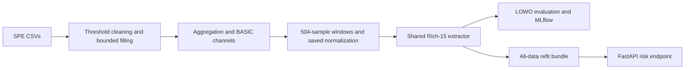

# ESP predictive maintenance

This project tests whether ESP sensor data can predict failure risk on **unseen wells**. It packages the SPE Ecuador E-Challenge benchmark as a reproducible classifier pipeline and a local FastAPI service, with MLflow tracking and Docker.

The central finding: fixed-horizon failure detection transfers across wells more successfully than precise remaining-useful-life regression.

## What stronger validation revealed about RUL regression

| SmallLSTM regression validation | Pooled R² | What the result supports |
|---|---:|---|
| Overlapping, interleaved | 0.919 | Invalid: adjacent windows shared approximately 98% of observations |
| Non-overlapping, interleaved | 0.608 | Interpolation within an observed well trajectory |
| Chronological 80/20, within-well | 0.457 | Exploratory future prediction for an observed well |
| Cross-well, three-fold GroupKFold | 0.005 | Transfer to previously unseen wells |

These are **archived exploratory SmallLSTM results**, from thesis v40 §4.2.6, Table 4.14. Window construction and sample counts differed between settings, so this table demonstrates protocol sensitivity, rather than a controlled estimate of the split's effect alone. The cross-well row uses **three-fold GroupKFold**, not LOWO. The classifier CLI does not regenerate this regression study. [Machine-readable evidence](evidence/regression_hierarchy.json).

## Flagship classification result: 168-hour failure risk

Threshold-BASIC uses **45 source channels → 675 Rich-15 features**, a strongly regularized histogram gradient boosting classifier, and a **fixed 0.5 threshold**.

| Evidence | Wells | Evaluated windows | Positive windows | AUC | AP | F1 | Precision | Recall |
|---|---:|---:|---:|---:|---:|---:|---:|---:|
| Primary Threshold-BASIC LOWO | 30 | 13,319 | 1,608 | 0.9464 | 0.8386 | **0.8205** | 0.8480 | 0.7948 |
| IQR 3.0 sensitivity | 29 | 12,246 | 1,593 | 0.9548 | 0.7821 | 0.8563 | 0.8693 | 0.8437 |

The sensitivity run changes the retained population and is not a direct replacement for the primary result. The primary confusion matrix is `[[11482, 229], [330, 1278]]` (`[[TN, FP], [FN, TP]]`); negative-window FPR is **1.96%**.

Per-well F1 is **0.7541 ± 0.3751** (population SD, `ddof=0`), with median [IQR] **0.969 [0.766–1.000]**. **24/30** wells reached F1 ≥ 0.70; **5/30** fell below 0.05. Strong pooled metrics therefore coexist with specific transfer failures:

| Held-out well | AUC | AP | F1 @ 0.5 | v40 interpretation |
|---|---:|---:|---:|---|
| DEEPWATER-1AD32W | 0.9957 | 0.9581 | 0.0351 | Threshold-scale mismatch despite strong ranking |
| DEEPWATER-TXV4MX | 0.9408 | 0.1160 | 0.0000 | Only 11 positive windows; severe imbalance and low AP |
| DEEPWATER-55X0XE | 0.8452 | 0.3063 | 0.0000 | Intermediate ranking; threshold adjustment alone cannot be assumed to rescue it |
| DEEPWATER-S0SAIU | 0.5169 | 0.1506 | 0.0000 | Near-chance ranking |
| DEEPWATER-AHJLPP | 0.3278 | 0.0861 | 0.0000 | Weak ranking; scores do not separate failures usefully |

Tuning a threshold against a target well's held-out labels would break the LOWO boundary, so it is not used. The archived pooled oracle F1 of 0.8218 is diagnostic only. [All 30 wells](evidence/per_well.csv) · [Archived metrics](evidence/classification_archived.json) · [Reproduction status](docs/reproduction.md).

The **served model is an all-data refit** on the eligible training surface. Its expected performance on new wells is **estimated by LOWO**, not measured on the served model itself. `failure_risk` is the class-weighted classifier's score, not a separately calibrated probability or an estimate of hours remaining.

## Run the service

Requires Docker Desktop with Linux containers and Docker Compose v2.

```sh
docker compose up --build -d --wait
python scripts/smoke_test.py
```

The smoke test sends `examples/request.json` and prints a valid risk response. The request is **synthetic**, contains no SPE telemetry, and demonstrates the interface rather than predictive accuracy.

Alternatively:

```sh
curl -X POST http://localhost:8000/predict -H "Content-Type: application/json" --data-binary @examples/request.json
```

- API and interactive docs: http://localhost:8000/docs
- Health: http://localhost:8000/health
- Model schema: http://localhost:8000/model-info
- MLflow UI: http://localhost:5000
- Stop: `docker compose down` (tracking data persists in a named volume).

The API works independently of MLflow. Both ports bind to the local machine. Docker's first build downloads the pinned dependencies; subsequent starts reuse the image.

## API contract

`POST /predict` takes `preprocessing_id`, `feature_names`, and `samples`: one **504 × 45 prepared, normalized BASIC window**, oldest sample first. Fetch the exact ordered channel names and preprocessing ID from `/model-info`. These are prepared model channels, not seven raw sensor readings. Do not normalize them a second time.

The service returns `failure_risk`, `horizon_hours: 168`, `threshold: 0.5`, `alert`, and `model_version`. Incorrect dimensions, channel order, preprocessing ID, nonnumeric values, or nonfinite values return HTTP 422. The bundle loads once at startup and is checked against its manifest, checksums, and library versions.

[Detailed model and input notes](docs/model-card.md).

## Obtain the data and reproduce the classifier

Download the original **SPE Ecuador Section E-Challenge – Prediction Models for Historical Data of ESP Patterns** materials from [the SPE Ecuador GitLab project](https://gitlab.com/spe.ec/e-challenge-prediction-models-for-historical-data-of-esp-patterns). Open its repository files and obtain/extract the telemetry CSVs in the **Train** dataset directory. Keep the official test data separate. The pipeline accepts that telemetry directory or an already-concatenated `train_data.csv`; files without `WELL_ID`, `DATE`, `CURRENT`, and `FREQUENCY` are skipped when loading a directory. Labels must be present in `WellFailure`; production tables are not used.

**No dataset is redistributed here.** The source materials are published under CC BY-NC-SA 4.0 for academic purposes; obtain the data from SPE and follow its terms. This project is independent and is **not affiliated with SPE**.

Install Python **3.11** and create an isolated environment:

```sh
python -m venv .venv
# Activate: .venv/Scripts/Activate.ps1 on Windows; source .venv/bin/activate on Linux/macOS.
python -m pip install -r requirements-dev.txt
python -m pip install --no-deps -e .
```

```sh
esp-pdm prepare --input /path/to/Train --out data/basic --reference-stats models/normalization.json
esp-pdm evaluate --data data/basic --out runs/lowo
esp-pdm train --data data/basic --out models/refit
esp-pdm export-request --data data/basic --row 0 --model-dir models/refit --out data/request.json
esp-pdm serve --model-dir models/refit
```

`--reference-stats` explicitly replays the archived normalization transformation. Omitting it fits new normalization statistics and produces a distinct preprocessing identity; do not assume that this regenerates the archived benchmark. Existing prepared outputs are not overwritten. `prepare` builds labelled research datasets; the inference endpoint requires no labels.

### LOWO protocol

One complete well is held out per fold. A held-out well needs at least three positive and three negative windows. The 32-well training surface contains 13,398 windows; 30 wells qualify for held-out evaluation, contributing 13,319 predictions. Non-evaluable wells remain available in the other wells' training folds.

The positive label is a finite next-event time ≤ 168 hours. Later finite-event windows are negatives. Post-repair negatives require window start after the inferred event and a full 168 hours of observed subsequent follow-up. Per-well negatives are capped at 10 times the positive count, accounting for existing negatives; other unknown-event windows are not automatically called healthy.

Each fold fits its own classifier `StandardScaler` on training wells, gives training wells equal total sample weight, and derives balanced class weights from training labels. The model configuration and threshold remain fixed. Prepared-window normalization is an explicitly saved upstream transformation; it is recorded separately from the fold-specific classifier standardizer. [Full pipeline and fitting boundaries](docs/pipeline.md).



### MLflow

Evaluation creates a parent run and one child run per held-out well. Model refits are separate runs with the exported model and feature signature. Hyperparameters, preprocessing IDs, evaluation metrics, OOF predictions, and reports are logged. Local run stores are excluded from Git.

By default the CLI uses `runs/mlflow.db` and `runs/mlartifacts`. View native local runs with:

```sh
mlflow server --backend-store-uri sqlite:///runs/mlflow.db --host 127.0.0.1 --port 5000
```

To log training into the **Compose** MLflow server instead, set `MLFLOW_TRACKING_URI=http://localhost:5000` before running `evaluate` or `train` (`$env:MLFLOW_TRACKING_URI='http://localhost:5000'` in PowerShell; `export MLFLOW_TRACKING_URI=http://localhost:5000` in a POSIX shell). The native SQLite store and Compose's named-volume store are separate. `--no-track` disables tracking without changing model fitting.

## Checks and repository boundaries

```sh
ruff check src tests scripts
pytest -q
```

GitHub Actions runs the tests, builds both container targets, starts Compose, and sends the example request. The repository contains the focused package, compact evidence, synthetic examples, and versioned serving bundle. Dataset arrays, experiment stores, notebook outputs, and thesis documents remain outside Git. The original thesis workspace and its history are preserved separately.
